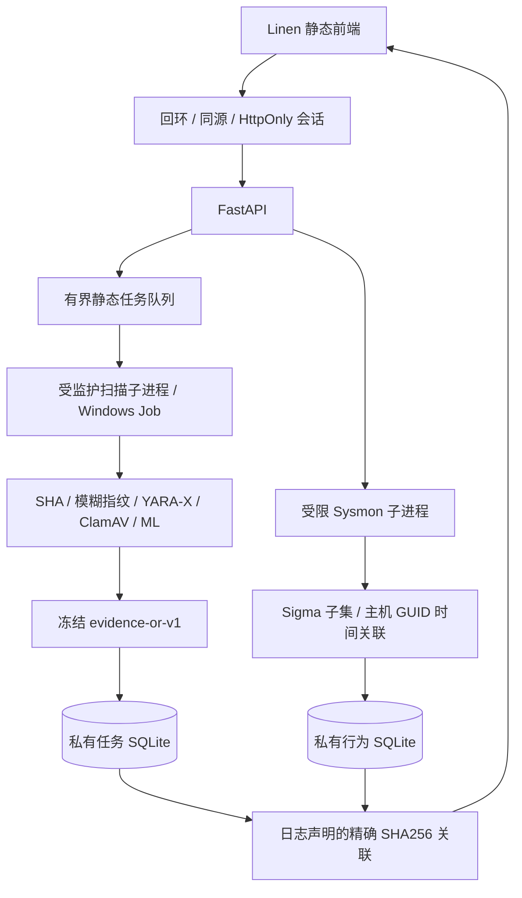

# AegisAV 软件架构与模块设计

## 部署边界

Linen 为 Next.js 静态构建，FastAPI 在同一个127.0.0.1来源服务前端和业务API。Windows交付包携带隔离搜索路径的 CPython 3.12.15 和固定依赖，不运行 Node.js。桌面控制器负责文件完整性、资源门槛、私有目录ACL、实例识别与有认证的正常退出。

后端保留三个责任边界：静态任务调度/报告、离线行为导入/报告、软件启动管理。私有模型位于包外。真实恶意PE仍仅由已有隔离Ubuntu分析机处理；当前产品不是自动动态沙箱。



可编辑源见 [architecture.mmd](../distribution/diagrams/architecture.mmd)。静态与行为结果分开；哈希声明只关联，不触发阈值变更。

## 静态扫描流程

请求先经认证和上传字节/文件数检查，使用幂等键与有序请求指纹去重重试，进入有界单Worker队列。逐文件在独立进程完成PE解析及五引擎调用；按版本身份缓存，不把失败/超时/弃权计作未命中。报告和文件/任务进度在事务中提交。取消、deadline及服务退出清理自有进程树。

模型支持通用PE及冻结Win64候选，但便携生产默认仍是通用profile。模型registry文件及特征适配器做哈希验证；模型缺失、架构不适用及运行失败明确弃权。默认ClamAV通过回环3310 INSTREAM连接已由用户配置的独立服务，控制器不停止它。

静态状态机：queued → running → completed / completed_with_errors / cancelled / timed_out / failed；重启遗留活动状态 → interrupted。持久报告不意味着原始上传可恢复，禁止伪造续扫。

## 行为流程

有界UTF-8 XML/规范JSON → 来源/字段/时间规范化 → 明确事件覆盖 → 固定Sigma规则语义匹配 → 进程生命周期关联 → 独立报告库。每个事件用日志SHA、输入序号及RecordID追踪。主机+GUID+时间优先；PID只在唯一显式闭合生命周期内回退，同名不是身份。

`matched`为行为信号；`incomplete`、`field_incompatible`、`unsupported`、`not_observed`、`unavailable`均不等于阴性。原生日志不持久保存，规范字段（包括命令行）会保存在私有报告库。此路径不执行日志命令。

## 存储和安全

SQLite任务schema1与行为schema1独立文件，WAL/FULL、事务、索引、完整性检查和保留余量。包外配置只接受外部模型/Python路径，访问密钥不写到配置或URL。Windows配置目录关闭继承，仅当前用户和SYSTEM。服务及解析器普通权限；Job有进程树内存/CPU/输出/时间边界，但不是文件系统或网络权限沙箱。

包内只放可分发源码、规则、运行时、依赖、预构建前端和无害示例；包清单逐文件SHA，外层ZIP另提供SHA。完整性哈希不等于代码签名或发行者认证。用户须从可信渠道取得包及摘要。

## 任务可靠性与资源边界（Schema 1）

### 部署与数据位置

继续运行 `python -m experiments.serve_local`，监听 `127.0.0.1:3417`，单 Uvicorn 进程。
沿用同源访问、Bearer/HttpOnly Cookie、Host/Origin 校验。不得开放公网或用于多用户托管。
Windows 使用 `%LOCALAPPDATA%/AegisAV/tasks.sqlite3`；Linux 使用 `$HOME/.local/share/AegisAV/tasks.sqlite3`。
可通过 `AEGISAV_TASK_DB` 指定仓库外私有路径。任务数据库与认证密钥分开，均禁止公开提交。
宿主机只扫描良性文件和无害夹具；真实恶意 PE 继续仅在既有离线隔离 Ubuntu VM 内静态处理。

### Schema 与事务

`PRAGMA user_version=1`。版本 0 的空库在单个 `BEGIN IMMEDIATE` 事务中创建以下结构；
遇到未来版本或损坏时拒绝启动，保留原文件，不自动覆盖、删库或重置。

| 表 | 字段与边界 |
| --- | --- |
| tasks | UUID 主键、状态、创建/更新时间、绝对截止时间、总数/已处理数、取消请求、请求指纹、唯一幂等键、服务版本、错误 |
| task_files | `(task_id, ordinal)` 主键、名称、大小、状态、报告 JSON（含引擎/规则/模型版本）、错误、耗时、任务内重复来源、更新时间 |
| task_events | 自增序号、任务外键、状态变更时间、状态及原因 |

任务创建、逐文件报告和进度更新各自在一个事务中提交；202 响应在创建提交后返回。
取消确认在取消意图提交后返回。任务终态、剩余文件终态及内存额度释放在同一管理器锁内完成。
主键/唯一键/外键/计数 CHECK 约束保护基本完整性；创建时间、状态和事件任务序号建立索引。
单连接由任务锁串行保护，启用 WAL、`synchronous=FULL`、foreign_keys、5 秒 busy_timeout。
启动执行 quick_check；损坏或数据库写入错误不会转换为阴性。运行期存储异常返回 503，
写入故障关闭新任务接纳，尚未持久化的状态不能保证重启后保留。
OS 文件锁保证单服务拥有该数据库；第二实例在启动时失败，不能把第一实例任务标为中断。

SQLite 不保存文件内容、Base64、访问密钥。文件名、哈希与检测证据仍属于私有任务数据。
历史列表通过 SQL 读取摘要和 verdict，不反序列化整批完整报告；每页最多 100 个任务，
`GET /v1/tasks?limit=50&offset=50`。报告按 ID 单独查询，无自动删除。

### 状态恢复与幂等

正常状态：queued → running → completed / completed_with_errors；取消：cancelling → cancelled。
任务截止：timed_out；存储/进程清理故障：failed 或 interrupted。逐文件失败、超时、取消均保留且没有阴性结论。
任务 finished 计数仅表示已尝试处理数量，未开始的中断/取消文件不伪造进度。

重启后已完成报告、错误、超时和取消状态可查询导出；旧 queued/running/cancelling 改为 interrupted。
已完成文件报告保留，未完成文件标记 resubmit_required。**没有自动续扫**：上传字节仅在内存，
不具备受控持久化文件暂存。重启不会重新下载、寻找任意宿主机路径或重放文件。

`POST /v1/tasks` 支持可选 `Idempotency-Key`（1–128 个 ASCII 字母/数字及 `-_.:`）。
指纹包含有序文件名、大小、SHA-256 和请求语义版本。相同键/指纹返回原任务 ID；
相同键不同内容、名称或顺序返回 409。不同键表示新用户意图，即使文件哈希相同也不会合并任务。
重启后重复请求继续返回原任务（包括 interrupted），不会因此重新执行。
若部署版本已改变，同键重试仍返回原报告及原服务/证据版本；新扫描必须使用新键。
任务内重复字节复用本任务已成功获得的完整报告，不将失败、弃权报告当作跨版本缓存。
前端在一次所选文件提交的网络重试中复用随机键，重新选择文件或提交成功后换键；不存储访问密钥到浏览器持久存储。

### 额度、截止与隔离

默认 1 个扫描调度 Worker，最多 4 个未结束任务、64 MiB 已接纳上传字节；
同时接收 2 个请求，单文件 16 MiB、单任务 20 文件/32 MiB，JSON 请求体 45 MiB。
背压返回 429 与 Retry-After，不能通过旧 `/v1/scan` 和 `/v1/scan/batch` 绕过生产任务额度。
单文件 120 秒，任务含排队时间共 600 秒。队列满时仍可回放已存在的幂等请求，但上传接收额度仍生效。
数据库超过 352 MiB 或磁盘不足 512 MiB 停止新接纳，保留空间给在途报告；不自动清理正式历史。
报告单文件上限 2 MiB；这是证据输出额度，超限作为失败而不是截断为成功。

生产每个不同文件使用独立扫描进程。Windows Job Object：总提交内存 2 GiB、最多 8 个子进程、
每进程 CPU 120 秒、KILL_ON_JOB_CLOSE；非提升权限执行，解析前加入 Job。
父服务独占 Job 生命周期句柄，服务强制退出也会清理扫描进程及 ML 子进程。
输入使用管道，独立传输线程防止 Windows 写入阻塞截止检查；取消/超时终止 Job 并等待传输线程退出。

Linux 需要非 root、支持 pidfd 的内核。单独的无解析器监护进程监听原服务 pidfd，
与解析器/子进程同处私有 session/process group；服务死亡或取消时清理整个进程组，
不依赖被阻塞解析器执行 Python 信号处理函数。解析器 RLIMIT_AS 为每进程 2 GiB，
CPU 120 秒，禁止 core，文件描述符 128，文件输出上限 2 MiB。
Linux RLIMIT_AS **不是总进程树内存上限**，ML 子进程还会按既有策略收紧至 1536 MiB；部署时需预留合计内存，
若需严格总内存上限，应在 VM 中通过受审 systemd/cgroup 配额追加约束。
本轮只在 Windows/WSL 用良性/无害夹具验证，没有启动 VM 或执行恶意文件。

这些措施提供故障和资源隔离，不构成对静态解析器漏洞的完整系统沙箱。
VM 网络、共享、剪贴板及拖放隔离要求保持原样。若无法确认清理，停止后续扫描并要求检查后重启。
每文件进程会增加冷启动成本、丢失跨任务内存缓存；本阶段优先可靠性，保留任务内去重，后续研究可终止的复用 Worker。
仅测试工厂允许直接注入内存扫描器；该适配器的取消为协作式，清楚标为 cooperative，正式 main 始终使用进程隔离。

### 保留与备份

默认保留所有正式报告和幂等记录，不按年龄或条数静默删除。达到空间门槛后先备份并由用户审定保留策略。
使用 SQLite backup API，而不是只复制正在使用的主库文件（WAL 中可能还有提交）：

```powershell
.venv/Scripts/python.exe -m experiments.backup_task_database PRIVATE_SOURCE_DB PRIVATE_NEW_BACKUP
```

目标必须是仓库外新文件，不覆盖旧备份；备份后完整性校验。恢复前停止服务，保留故障库和 WAL/SHM，
恢复到新的私有路径并设置 AEGISAV_TASK_DB；不要擅自覆盖或回滚正式数据。
旧内存服务的历史没有可恢复字节，不能被本次迁移伪造为已持久化；已导出的正式记录继续保留。

### 验证命令

```powershell
.venv/Scripts/python.exe -m pytest -q
$env:NEXT_TELEMETRY_DISABLED='1'
npm --prefix frontend run build
$env:AEGISAV_PLAYWRIGHT_MODULE='ABSOLUTE_PLAYWRIGHT_MODULE'
node frontend/scripts/check-task-reliability.cjs
node frontend/scripts/check-live-api.cjs
```

Linux 无害进程探针：`PYTHONPATH=backend python3 -m experiments.check_linux_process_guard`。
验收服务 `experiments.task_reliability_fixture` 需要显式开关，只供本机故障注入；不部署为正式服务。

### 既有 VM 的历史资源验收边界

`vm/Get-TaskGuardReadiness.ps1` 只读检查既有专用 VM 的离线 VMX、电源和宿主资源，不启动/停止 VM、读取凭据、改配置或恢复快照。
`guest_validation_performed=false` 或前置检查 ready 都不是客户机隔离/分析通过；deferred_memory 也不是检测失败。

2026-10-17 曾获准仅将既有客户机 memsize 改为 6144 MiB，冷启动保留至少 2 GiB 宿主余量（当时需 8 GiB 可用）。
串行无害检查和隔离静态工作负载通过，扫描 cgroup 2 GiB、独立 clamd 2.5 GiB；这不是最坏情况容量保证。
未更改 swap、并发或 Worker，不新增 VM，不强制回收其他进程。本次文档整理没有启动 VM 或重新确认其现时配置。

真实实验前仍须核对实际配置和资源门槛、VMware Tools 客户机隔离、无非回环接口/路由、空闲任务和无害进程检查。
需要 TCP ClamAV 的离线 unit 只允许 localhost；等精确冻结库版本就绪后再比较，保留失败/中断/版本未知尝试。
正常关机和快照边界不变。完整历史记录见 [R4 VM 资源实验](https://github.com/Skylar-Jiang/AgeisAV/blob/cd6bb64ea96c1ebde17eecece7854e0fa248a451/docs/research/ROUND_REPORT_20261017_STAGE_E_R4_VM_PUBLIC.md)。
