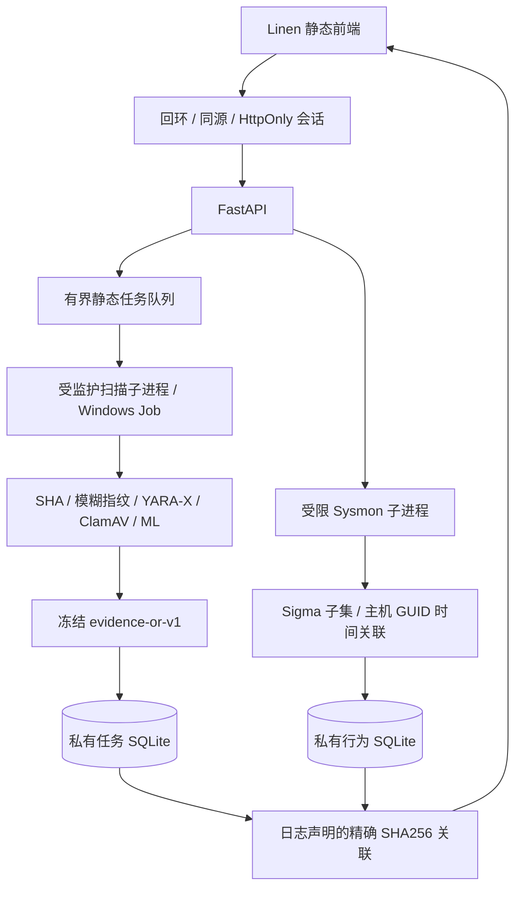

# AegisAV 软件架构与模块设计

## 部署边界

Linen 为 Next.js 静态构建，FastAPI 在同一个127.0.0.1来源服务前端和业务API。Windows交付包携带隔离搜索路径的 CPython 3.12.15 和固定依赖，不运行 Node.js。桌面控制器负责文件完整性、资源门槛、私有目录ACL、实例识别与有认证的正常退出。

后端保留三个责任边界：静态任务调度/报告、离线行为导入/报告、软件启动管理。私有模型位于包外。真实恶意PE仍仅由已有隔离Ubuntu分析机处理；当前产品不是自动动态沙箱。

可编辑源见 `diagrams/architecture.mmd`。静态与行为结果分开；哈希声明只关联，不触发阈值变更。

## 静态扫描流程

请求先经认证和上传字节/文件数检查，使用幂等键与有序请求指纹去重重试，进入有界单Worker队列。逐文件在独立进程完成PE解析及五引擎调用；按版本身份缓存，不把失败/超时/弃权计作未命中。报告和文件/任务进度在事务中提交。取消、deadline及服务退出清理自有进程树。

模型支持通用PE及冻结Win64候选，但便携生产默认仍是通用profile。模型registry文件及特征适配器做哈希验证；模型缺失、架构不适用及运行失败明确弃权。默认ClamAV通过回环3310 INSTREAM连接已由用户配置的独立服务，控制器不停止它。

静态状态机：queued → running → completed / completed_with_errors / cancelled / timed_out / failed；重启遗留活动状态 → interrupted。持久报告不意味着原始上传可恢复，禁止伪造续扫。

## 行为流程

有界UTF-8 XML/规范JSON → 来源/字段/时间规范化 → 明确事件覆盖 → 固定Sigma规则语义匹配 → 进程生命周期关联 → 独立报告库。每个事件用日志SHA、输入序号及RecordID追踪。主机+GUID+时间优先；PID只在唯一显式闭合生命周期内回退，同名不是身份。

`matched`为行为信号；`incomplete`、`field_incompatible`、`unsupported`、`not_observed`、`unavailable`均不等于阴性。原生日志不持久保存，规范字段（包括命令行）会保存在私有报告库。此路径不执行日志命令。

## 存储和安全

SQLite任务schema1与行为schema1独立文件，WAL/FULL、事务、索引、完整性检查和保留余量。包外配置只接受外部模型/Python路径，访问密钥不写到配置或URL。Windows配置目录关闭继承，仅当前用户和SYSTEM。服务及解析器普通权限；Job有进程树内存/CPU/输出/时间边界，但不是文件系统或网络权限沙箱。

包内只放可分发源码、规则、运行时、依赖、预构建前端和无害示例；包清单逐文件SHA，外层ZIP另提供SHA。完整性哈希不等于代码签名或发行者认证。用户须从可信渠道取得包及摘要。
